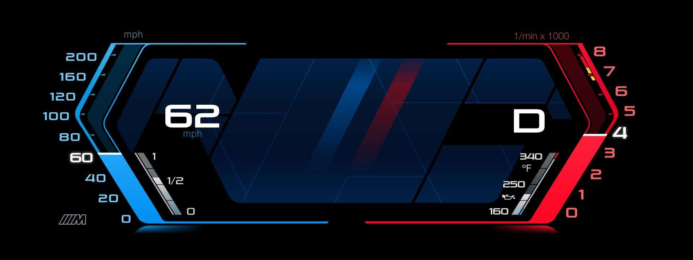
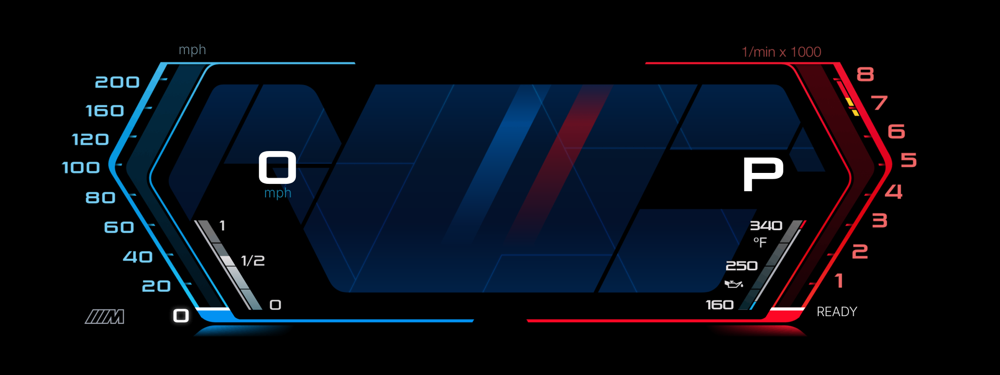
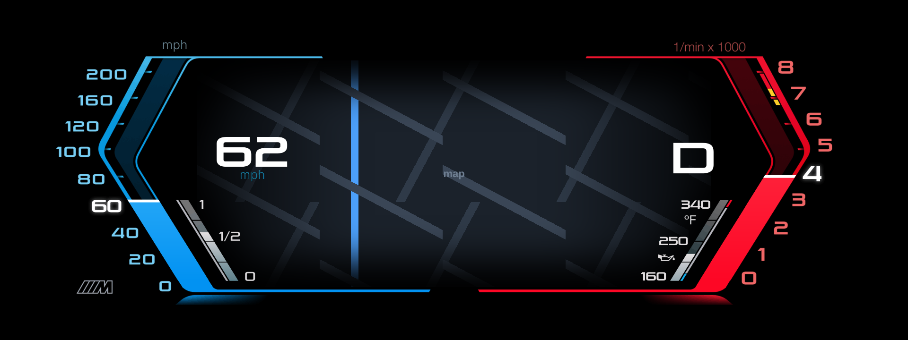
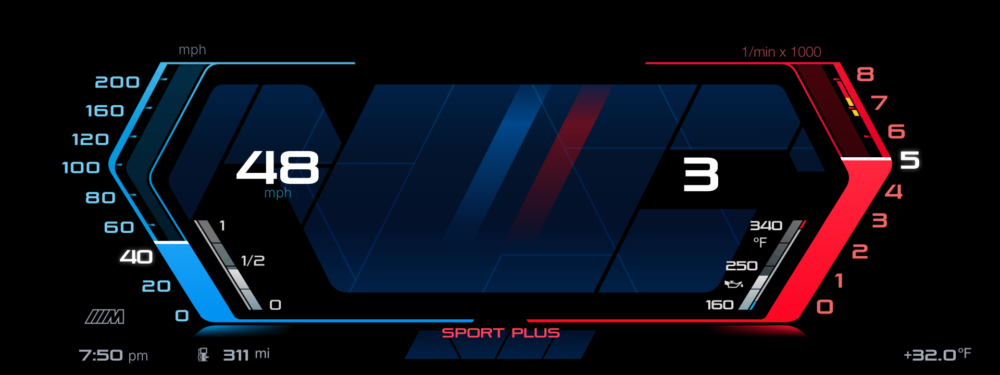

# M340i Sport layout

This is a copy of [eroobeeroo/idrive7-cluster-info](https://github.com/eroobeeroo/idrive7-cluster-info)
(at commit 10cefda) with one more layout for **Cluster Layouts**: **M340i Sport**, a Figma design for a
petrol M340i (G20, B58) with iDrive 7 (MGU) and the 12.3" Live Cockpit Professional cluster.
Everything else is the original project, under its own licence and notices
(`LICENSE`, `NOTICE.md`): free, noncommercial, credits kept.



| Engine off | Waze map | Full screen, manual, SPORT PLUS |
|---|---|---|
|  |  |  |

*(Drawn by `tools/preview.js` from the shaders and textures the cluster gets. Not yet seen on a car.)*

## What the layout is

The picture is the design itself. `tools/m340/prototype.html` is the design's prototype page (the Figma
export with its moving parts); `tools/bake_m340.py` draws that page at the cluster's size and stores it in
`apps/cluster_layouts/m340_art.js`. The layout (`layout_m340.js`) shows that picture and adds what moves:

- Speed 0-200 mph and revs 0-8 (x 1000). The reading fills the whole gauge in the design's gradient, over
  the tick marks and out to both lines, and runs into the bottom line; a white bar sits across it at the
  reading. The numeral nearest the reading is white, larger and glowing.
- The speed and the gear in the design's lettering. Gear: `D` (or `S`) alone in automatic, the gear's
  number alone (1-8) in manual, `P` / `R` / `N`.
- Fuel bar, and the oil temperature bar on 160 / 250 / 340 °F.
- Engine off: READY stands where the rev scale's 0 is; the 0 comes back when the engine runs.
- Waze map: it fills the hexagon between the gauges, its edges faded out as in the design, with the
  gauges and figures over it.
- With the car's own bottom strip (the default) the car shows the range, time, outside temperature and
  drive mode. With *Bottom strip: the layout's*, the design's bottom row shows them: the drive mode as the
  car names it, ECO PRO light blue, SPORT and SPORT PLUS red, COMFORT white.

The design is in mph, °F and miles, whatever the unit settings.

### How close it is to the design

Above the car's strip the cluster's picture is the prototype's, pixel for pixel, within what 256 colours a
part allow (mean difference 0.4 of 255 levels). The gear and READY sit on the design's exact sub-pixel
places. The speed's figures sit on whole pixels, so their edges can differ by up to half a pixel.

Three things are placed differently from the design, on purpose:

- full screen, the gear is left of the design's place, and the drive mode a little higher: the cluster
  keeps a dark box of its own and its warning lights there;
- a range too wide for its place moves up to 10 px right, so it does not run into the fuel pump symbol.

### What it costs the cluster

| | |
|---|---|
| Layers | 14 with the car's strip, 16 full screen, 20 with the map (the renderer allows 64 an app) |
| Sent once | about 610 KB: the picture as tiles and palettes, the glyph sheet (a plain 1920x720 picture is 5,400 KB) |
| Sent while driving | about 40 messages and 2.5 KB a second in a simulated drive; nothing while nothing changes |
| Drawn area | 1.1 million pixels of picture a frame with the car's strip: each layer's rectangle is cut to what the picture draws in it |

A line of figures is one uniform, so a new speed is one message. The drive mode's name is one layer.

The speed and rev fills glide: each new reading from the car is sent as a short straight-line animation that
the cluster plays itself, over about the time between the car's readings (measured, 30-140 ms). The fill moves
at the cluster's own frame rate between readings, however busy the head unit is, and one message goes per
reading instead of one per frame. It reaches each reading about one reading-interval later than a jump would.

## Install

1. Create a new **public** repository on GitHub and upload the contents of this folder to it
   (`git init`, `git add -A`, `git commit`, `git push`, or "Add file > Upload files" in batches).
2. On the car, in the **MGU Store**, add your repository as a source (`yourname/yourrepo`) and install
   **Cluster Layouts** from it. Remove the original Cluster Layouts first if it is installed.
   The Store installs what the app needs (the cluster renderer, the GPU renderer, the controller gate).
3. Cluster Layouts > Settings:
   - Layout: **M340i Sport**
   - Vehicle: **Petrol or diesel**
   - Fuel tank size: **59 L**
   - leave the rest as it is (the car's own bottom strip, red zone from 7000)
4. For the map: install **Waze on cluster** (0.9.107 or later, from `eroobeeroo/idrive-apps`), set the car's
   *Central display area* to *Map view*, and set *Centre of the cluster* to **Waze**.
5. Press **Show on the cluster**. Check it parked first, and switch it off if anything is hidden.

It needs the MGU Store already running on the head unit (see
[robertnisipeanu/mgu-store](https://github.com/robertnisipeanu/mgu-store)). It does not work on
iDrive 8 or 8.5 cars.

## Before you publish it

The repository has to be public for the Store, and the layout's files carry other people's work:

- **The artwork** (`tools/m340/prototype.html`, `m340_art.js`, the previews) is made from a Figma Community
  file. Check that file's licence and credit its author here as it asks.
- **The lettering** is drawn with the Pirulen typeface: the prototype holds outlines of its figures and
  capitals, and `m340_art.js` pictures of them. Check that your Pirulen licence allows that in a published app.
- **The M logo** in the artwork is BMW's trademark.

## Changing the design

Edit `tools/m340/prototype.html` (or replace it with a new export of the prototype page), then:

```
python3 tools/bake_m340.py --shots     # needs Playwright with a Chrome, Pillow, numpy
node tools/sync_shared.js              # only after editing shared/
node tools/test_engine.js && node tools/test_app.js && node tools/test_shared.js && node tools/clearance.js
node tools/preview.js --layout m340 --strip --engine --speed 62 --rpm 4000 --out preview.png
```

## What changed against the original

| File | Change |
|---|---|
| `apps/cluster_layouts/layout_m340.js` | new: the layout |
| `apps/cluster_layouts/m340_art.js` | new, generated: the design's picture as the cluster takes it |
| `tools/bake_m340.py`, `tools/m340/prototype.html` | new: the tool that makes it, and the design it is made from |
| `apps/cluster_layouts/layouts.js`, `app.json` | lists the layout; version 0.29.0 |
| `shared/shaders.js` (and each app's copy) | the `m340…` shaders: the picture, a gauge with its reading, a bar gauge, lettering, the map's veil |
| `shared/engine.js` (and each app's copy) | textures a layout brings itself (format, sampling, shared between layers); a layout without the glyph atlas; a changed uniform sent by itself, arrays as `vec4` |
| `shared/engine.js`, `shared/cluster_render_client.js` | `glide: true`: a value played by the cluster between readings; an animation can replace one by its number |
| `tools/preview.js`, `tools/scene.js`, `tools/test_engine.js`, `tools/clearance.js` | nearest-sampled textures in the preview; the checks know a design's own artwork; the test client replaces animations and the preview shows an animated value where it ends |
