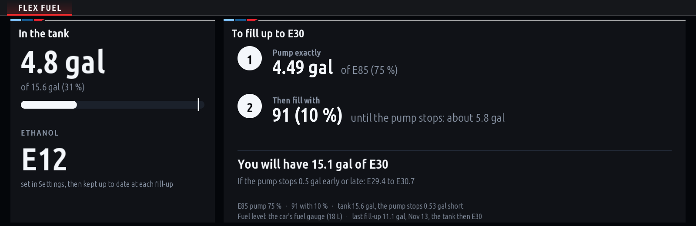

# Flex Fuel

How much E85 and how much gasoline to put in to reach the ethanol mix you want, on the head unit's screen.

## What it does

- Reads the fuel in the tank from the car's own fuel gauge (`KombiIF.statusRangeTankStatus`). If the car gives
  no level, set it by hand in Settings (in eighths of a tank).
- Knows the mix already in the tank: you set it once, then the app keeps it up to date after each fill-up.
- Tells you the fill-up in two steps:
  1. **Pump exactly** this much of one fuel (watch the pump's display and stop there).
  2. **Then fill with** the other **until the pump stops**.
- Allows for the pump stopping before the tank is really full: the room it fills is the tank's size less
  *The pump stops before the tank is full by* (Settings).
- Puts the fuel closer to your target last, so the click-off's own variation moves the mix least, and shows the
  mix you would get if the pump stopped half a gallon early or late.
- Says when the mix can't be reached in one fill-up, and gives the closest you can get.

## Settings

| Setting | What to set |
|---|---|
| Mix I want | E10 to E85 |
| The E85 pump's real ethanol | 50-85 %: E85 is often 70-80 % (test it, or use your station's figure) |
| Gasoline | its grade: 87, 89, 91, 93, 94 |
| Ethanol in that gasoline | 0-15 %: 10 % for most pump gas, 0 % for ethanol-free |
| Ethanol in the tank now | set it once (an ethanol content analyser or your last known mix); the app updates it |
| Fuel in the tank | the car's fuel gauge, or eighths of a tank by hand |
| Tank size | 59 L (15.6 gal) for an M340i |
| The pump stops before the tank is full by | how much room is left when the pump clicks off (default 2 L, about half a gallon) |
| Fill to the click with | which fuel goes last: automatic (recommended), the gasoline or the E85 |
| Units | US gallons or litres |

## Fill-ups

The app counts a fill-up when the car's fuel level rises by 3 L or more and then stays still for a minute
(usually right after you start the car at the pump). It works out the new mix from the plan that was on the
screen and the fuel actually added:

- added less than step 1's amount: all of it counts as the measured fuel;
- added more: step 1's amount of the measured fuel, the rest the top-off fuel.

If you put in something else, set *Ethanol in the tank now* by hand afterwards.

## How exact it is

The plan is only as exact as what it is told:

- the car's fuel gauge reads to about a litre, and lags a little after a fill-up;
- the E85 pump's real ethanol varies by station and season;
- where the pump clicks off varies by a few tenths of a gallon (the page shows what that does to the mix).

The B58 has no ethanol content sensor, so the app can't measure the mix; it keeps count of what went in. Check
the mix with an ethanol content analyser now and then, and set it in Settings when it differs.

Running ethanol blends needs a tune made for them. This app does the arithmetic only.

## Files

| File | |
|---|---|
| `main.js` | the page, the car's fuel level, fill-ups |
| `mix.js` | the blend arithmetic |
| `app.json` | the app's settings and its one car signal |
| `kit/tools/test_flex_fuel.js` | its tests (`node kit/tools/test_flex_fuel.js page.png` also draws the page) |
