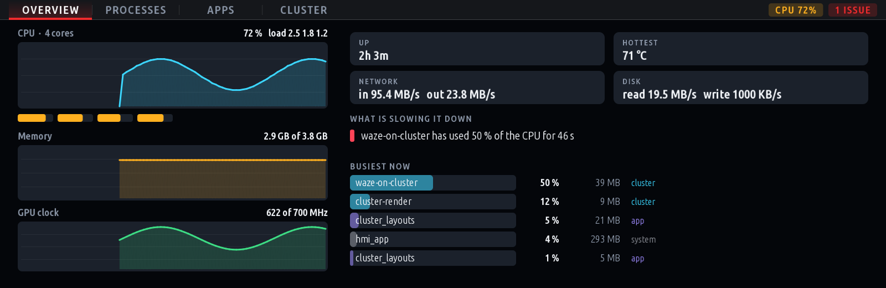
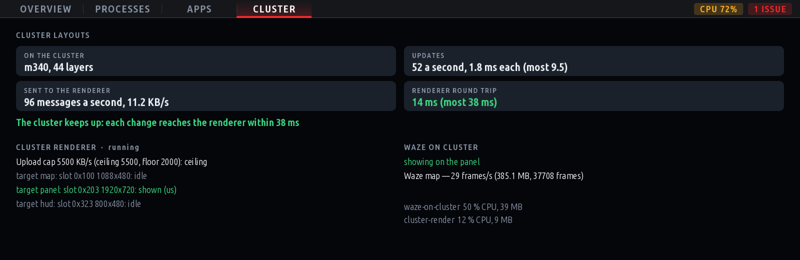

# Task Manager

What the head unit is doing, on its own screen: how busy it is, what takes the most, and whether the cluster keeps
up.

## Pages

Tap a tab, or turn the iDrive controller along them.

| Page | What it shows |
|---|---|
| **Overview** | CPU (all cores together, and a bar for each core), memory and the GPU's clock over the last three minutes; uptime, the hottest temperature sensor, the network's and the disks' rates; **What is slowing it down** (a process over a quarter of the CPU for a while, the CPU over 85 % busy, memory nearly full, a hot chip, more work waiting than the cores can run); the busiest processes now |
| **Processes** | every process, busiest first: its kind (a Store app, the cluster's and map's services, or the system), PID, CPU share, its last minute as a trend line, memory, threads and state. **Next** turns the page, **Sort** switches between CPU and memory |
| **Apps** | the Store apps and the cluster, map and Store services, each app's processes counted together, with their CPU over the last minutes and their memory |
| **Cluster** | Cluster Layouts on the cluster: its updates a second and how long each takes, the messages it sends to the cluster renderer, and the renderer's **round trip** (how long a change takes to reach it: green under 60 ms, amber under 200 ms, red beyond, when the head unit is overloaded); the renderer's upload cap and targets; Waze on cluster's state and frame rate |

## Settings

| Setting | What it does |
|---|---|
| Refresh every | 1, 2 or 5 seconds |
| Sort processes by | CPU or memory |
| CPU percentages | a share of all the cores together (100 % = every core busy), or 100 % a core as `top` counts |
| Watch the processes while closed | on: the processes are looked at every 10 s while the app is closed, so one that took a lot meanwhile still shows in What is slowing it down |

## How light it is

- The system's own figures (a few small files in `/proc` and `/sys`) every refresh; the processes, a pass over
  `/proc`, at each refresh only while the page is open, else every 10 s (or never, with Watch while closed off).
- The page is drawn only when something changed.
- It only reads: `/proc`, `/sys`, `/run/cluster-render/status.txt`, `/run/waze-on-cluster/status.json` and Cluster
  Layouts' `/dev/shm/cluster-info/layouts_perf.json`. It stops nothing and needs no privileges.

The GPU shows as its clock against its most: Intel's i915 driver gives no busy figure an app may read.

## Tests

`node kit/tools/test_task_manager.js [folder]` reads a stand-in `/proc` and `/sys`, checks the figures, the names,
the hogs and each page; with a folder it writes each page there as a PNG.
